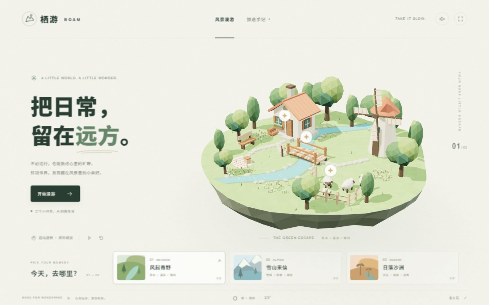

# 栖游 · ROAM

一个可以直接部署到 GitHub Pages 的纯静态 3D 风景小游戏。转动浮岛、发现闪光、收集旅途手记，在三个微缩世界里慢下来。



## 三个小世界

- **风起青野**：草地、溪流、风车与林间小屋。
- **雪山来信**：雪峰、松林、湖泊与山间木屋。
- **日落沙洲**：砂岩拱门、棕榈绿洲与土坯驿站。

每个场景有 3 枚风景碎片，共 9 枚。收集进度使用 `localStorage` 保存在当前浏览器、当前站点，不需要账号，也不会同步到其他浏览器或设备。清除站点数据会清除手记；可在「旅途手记」中点击「重新收集」并再次确认来重置。

项目使用 **Three.js + TypeScript + Vite**。地形、建筑、植物和装饰均由代码生成，环境音通过 Web Audio 合成，无后端、无外部图片或音频素材依赖。构建结果是标准静态文件。

## 本地运行

建议使用 Node.js **22.12 或更新版本**及 npm。在项目目录打开终端：

```powershell
git clone https://github.com/SueZ66/roam-scenes.git
cd roam-scenes
npm ci
npm run dev
```

打开终端显示的本地地址。开发服务器默认绑定 `127.0.0.1`，默认端口为 `5173`；端口占用时以终端输出为准。

生成生产文件：

```powershell
npm run build
```

该命令先执行 TypeScript 检查，再构建到 `dist/`。预览生产构建：

```powershell
npm run preview
```

打开终端给出的预览地址。请通过开发服务器、预览服务器或静态托管访问，不要直接双击 `index.html`。

## 交互方式

- 拖动旋转浮岛，滚轮缩放；触屏设备可单指旋转、双指缩放。
- 点击下方场景卡片切换目的地，或使用键盘 `1`、`2`、`3`。
- 点击岛上的闪光收集碎片，在「旅途手记」查看已发现的名称与寄语。
- 点击工具栏控制自动旋转、重置视角；空格键可切换自动旋转。
- 环境音默认关闭，可点击右上角声音按钮开启；旁边提供全屏入口。

需要支持 **WebGL 2** 的现代浏览器，建议开启硬件加速。设备性能会影响 3D 渲染帧率；浏览器的音频、全屏与本地存储设置也可能影响相应功能。

## 部署到 GitHub Pages

仓库已提供 `.github/workflows/deploy.yml`，向 `main` 分支推送后自动构建并发布 `dist/`。

1. 创建 GitHub 仓库，将**本项目目录的内容**放在仓库根目录，确保 `package.json` 与 `.github/` 位于根目录。
2. 将代码推送到仓库的 **`main` 分支**。
3. 打开仓库 **Settings → Pages → Build and deployment**，把 **Source** 设为 **GitHub Actions**。
4. 在 **Actions** 页面查看 **Deploy to GitHub Pages**。如果首次推送发生在 Pages 配置之前，可选择该工作流并点击 **Run workflow**，以 `main` 分支重新运行。
5. 等待 `build` 与 `deploy` 成功后，从部署结果或 **Settings → Pages** 打开站点地址。

工作流使用 Node.js 22，执行 `npm ci`、`npm run build`，然后上传和发布 `dist/`。`vite.config.ts` 已配置 `base: './'`，可适配 GitHub Pages 的仓库子路径。若采用其他分支，需要同步调整工作流中的触发分支。

在线展示地址：[SueZ66.github.io/roam-scenes](https://suez66.github.io/roam-scenes/)。首次发布完成后即可访问；之后推送到 `main` 会自动更新站点。部署状态以仓库的 Actions 记录为准。

## 文件结构

```text
roam-scenes/
├─ .github/workflows/deploy.yml  # GitHub Pages 构建与发布
├─ public/                      # 本地静态资源
├─ src/
│  ├─ main.ts                   # 页面、渲染器、相机、交互与收集进度
│  ├─ style.css                 # 页面样式与响应式布局
│  ├─ audio.ts                  # Web Audio 环境音与收集音效
│  └─ scenes/
│     ├─ types.ts               # 场景与收集点接口
│     ├─ meadow.ts              # 青野场景
│     ├─ alpine.ts              # 雪山场景
│     └─ desert.ts              # 沙洲场景
├─ index.html
├─ package.json
├─ package-lock.json
├─ tsconfig.json
└─ vite.config.ts
```

## 扩展场景

场景工厂返回 `Landscape`，包含一个 Three.js `Group`、收集点数组 `collectibles`，以及每帧执行的 `update(elapsed, delta)`。收集点提供世界坐标 `position`、名称 `name` 和寄语 `message`；相机、灯光、交互按钮及收集标记由 `main.ts` 统一管理。

修改已有场景时，保持工厂接口与 3 个收集点即可沿用当前界面。新增第四个场景时，需在 `main.ts` 注册，并同步调整场景数量、收集总数、快捷键、本地存储 ID 校验及相关界面文案。几何尽量合批或实例化，避免大量独立 Mesh 增加绘制开销。
